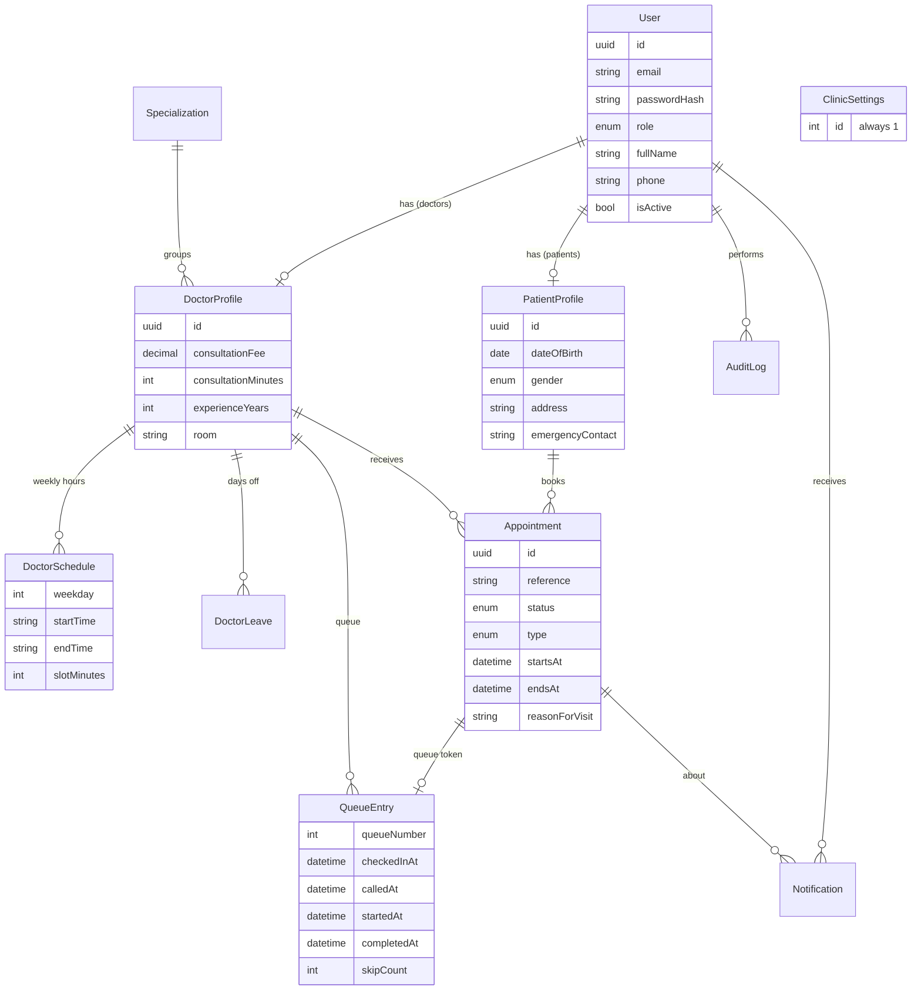

# Healthcare Appointment & Queue Management System (HAMS)

A full-stack web app for a small clinic: patients book appointments and watch their place in the queue live, doctors run their consultation queue, receptionists handle check-in and walk-ins, and admins manage doctors, settings and reports.

> **Educational project. All data is fictional.** The app does not diagnose, treat or give medical advice. Do not store real patient information in it.

| Layer | Technology |
|---|---|
| Frontend | React 18 (Vite), React Router, Axios, Lucide icons, Recharts, Socket.IO client |
| Backend | Node.js, Express, Zod validation, JWT in an httpOnly cookie, bcrypt, helmet, CORS, rate limiting |
| Database | PostgreSQL with Prisma (schema, migrations, seed) |
| Real time | Socket.IO, with automatic 15 second polling if the socket is down |
| Tests | Vitest + Supertest against a separate PostgreSQL test database |

---

## 1. What you need installed (Windows)

1. **Node.js 18.18 or newer (LTS)**: https://nodejs.org. Check with `node -v`.
2. **PostgreSQL 14 or newer**: https://www.postgresql.org/download/windows/. Remember the password you set for the `postgres` user. Keep the default port `5432`.
3. **VS Code**: https://code.visualstudio.com (any terminal works; the steps use the VS Code terminal).

## 2. First-time setup

Open the project folder in VS Code and open **two terminals** (Terminal menu, New Terminal). One will run the server, the other the client.

### 2.1 Server (terminal 1)

```bash
cd server
npm install
copy .env.example .env
```

Open `server/.env` and change two things:

* `DATABASE_URL`: replace `YOUR_PASSWORD` with your PostgreSQL password.
* `JWT_SECRET`: use any long random text. To generate one: `node -e "console.log(require('crypto').randomBytes(48).toString('hex'))"`

Create an empty database called `hams` once (pgAdmin: right-click *Databases*, *Create*, *Database*, name `hams`; or in a terminal: `createdb -U postgres hams`). Then create the tables and add the fictional demo data:

```bash
npm run db:init       # applies the migration (creates all tables)
npm run db:seed       # fictional doctors, patients and appointments
npm run dev           # API on http://localhost:5000
```

> If you want to try the live queue at any time of day (the normal seed only opens doctors during working hours), use `npm run db:seed:demo` instead of `db:seed`. It makes the clinic and doctors open 24/7.

### 2.2 Client (terminal 2)

```bash
cd client
npm install
npm run dev           # app on http://localhost:5173
```

Open **http://localhost:5173**. The Vite dev server forwards `/api` and `/socket.io` to the API, so cookies and live updates work without any CORS setup. Leave `client/.env` absent (or empty).

## 3. Demo accounts (all fictional)

| Role | Email | Password |
|---|---|---|
| Admin | admin@hams.test | Admin@123 |
| Receptionist | reception@hams.test | Reception@123 |
| Doctor | ananya.rao@hams.test (and 7 other doctors) | Doctor@123 |
| Patient | patient@hams.test (also patient2 ... patient30) | Patient@123 |

## 4. Try it in five minutes

1. Log in as **patient@hams.test**, open *Book appointment*, pick a doctor, a date and a free time. You get a reference and a queue number.
2. Log in as **reception@hams.test** (use a private window so you stay logged in as the patient). Open *Check-in*, find the patient and check them in. Then add a *Walk-in*.
3. Log in as **the doctor** you booked with. Open *Queue*, press *Call next patient*, then *Start consultation* and *Complete*.
4. Watch the patient window: *Live queue* updates by itself (position, now serving, estimated wait).
5. Log in as **admin** and open *Reports* and *Audit log*: everything you just did is there, calculated from the real records.

## 5. Features by role

* **Public**: landing page, about, doctor directory with filters, doctor detail, register, login.
* **Patient**: dashboard, book (doctor, date, free slot), confirmation with calendar file, my appointments (search, tabs), reschedule and cancel (before the cut-off), live queue tracker, notifications, profile and password.
* **Doctor**: dashboard, appointments by day, queue management (call next, start, complete, skip, no-show), weekly schedule, leave (can cancel affected appointments and notify patients).
* **Receptionist**: dashboard, patient check-in, walk-in registration (existing or new patient), book for a patient, daily queue for all doctors (seat, skip, no-show, move in line), appointment lookup.
* **Admin**: dashboard, users (create, edit, reset password, deactivate), doctors (create, edit, schedule, deactivate), specializations, all appointments, reports with CSV download, audit log, clinic settings.

## 6. Booking rules

* A slot is only offered if it is inside the doctor's working hours, not on leave, not on a closed weekday, not in the past and not already taken.
* **No double booking**, in three layers: the server re-checks the slot, the booking runs in a *Serializable* transaction that retries on conflict, and the database has partial unique indexes (`appointment_active_slot_key`, `appointment_patient_doctor_day_key`) so even a bug cannot create two active bookings for one slot. A patient also cannot hold two active appointments with the same doctor on the same day.
* Patients can cancel or reschedule until `cancellationCutoffHours` before the visit; reschedules are limited per appointment.
* Every important change is saved in the audit log.

## 7. Queue rules

* Each appointment gets a **queue number** (a token for that doctor and day).
* Statuses: Booked, Confirmed, Checked in, Waiting, Called, In consultation, Completed, Cancelled, No-show.
* The calling order follows the booked slot time. A patient who arrives later than the grace period is placed by **check-in time** instead, so on-time patients are not pushed back.
* **Skip**: the patient moves back in the line. A **second skip becomes a no-show**.
* Booked patients who never check in are marked no-show automatically by a background job after `noShowAfterMinutes`.
* **Walk-ins** take the next free slot, or join the end of the queue when the day is full (limited by `maxDailyWalkIns`).
* The **estimated wait** is labelled as an estimate everywhere: remaining time of the current consultation plus (patients ahead x the doctor's real average consultation time, falling back to the configured length when there is no history yet).

## 8. Running the tests

Tests delete data, so they use their **own database**. Never point them at your real one (the test helpers refuse any database whose name does not contain `test`).

```bash
cd server
copy .env.test.example .env.test      # set your password; database name stays hams_test
npm run test:db                       # creates/updates the hams_test tables
npm test
```

The suite covers registration and login, role permissions, availability, booking, double booking (including 6 simultaneous requests for one slot), cancellation and rescheduling, queue progression, privacy (a patient can never read another patient's data), analytics and invalid input.

## 9. Folder structure

```
healthcare-appointment-system/
  client/                  React app (Vite)
    src/
      components/          shared UI (ui/, charts/, queue/, booking form, slot picker ...)
      context/             auth, settings, socket, toast, confirm dialog
      hooks/               useFetch, useLive (socket + polling), useDebounce
      layouts/             dashboard shell, public layout, notification bell
      pages/               public/ patient/ doctor/ reception/ admin/ shared/
      routes/              route table and role guard
      services/api.js      the one Axios instance
  server/                  Express API
    prisma/                schema.prisma, migrations/, constraints.sql, seed.js
    src/
      routes/ controllers/ services/ validators/ middleware/ utils/ sockets/ jobs/
    tests/                 Vitest suites
    scripts/               db-init.js, test-db.js
```

Request flow: **route -> validation (Zod) -> controller -> service -> Prisma**. Every error is returned as `{ "error": { "code", "message", "details" } }`.

## 10. Database diagram



## 11. API overview

All routes are under `/api`. Everything except the public ones needs the login cookie. "Roles" shows who may call it.

| Method and path | Roles | Purpose |
|---|---|---|
| POST `/auth/register`, `/auth/login`, `/auth/logout` | public | account and session |
| GET `/auth/me` | any | current user |
| GET, PATCH `/profile`, POST `/profile/change-password` | any | own profile |
| GET `/settings/public` | public | clinic name, hours, rules |
| GET `/specializations` | public | list; POST, PATCH, DELETE are admin only |
| GET `/doctors`, `/doctors/:id` | public | directory |
| GET `/doctors/:id/slots?date=` | logged in | free and taken slots |
| GET, PUT `/doctors/:id/schedule` | logged in / doctor, admin | weekly hours |
| POST, DELETE `/doctors/:id/leaves` | doctor, admin | leave |
| POST `/doctors`, PATCH `/doctors/:id`, PATCH `/doctors/:id/status` | admin | manage doctors |
| POST `/appointments` | patient, receptionist | book |
| GET `/appointments`, `/appointments/:id` | scoped by role | list and details |
| POST `/appointments/:id/cancel`, `/reschedule` | owner / staff | change a booking |
| PATCH `/appointments/:id/status` | doctor | confirm, start, complete |
| GET `/queue/doctor/:id` (or `me`), `/queue/overview` | doctor, staff | queue state |
| GET `/queue/my-status/:appointmentId` | patient | own place and estimate |
| POST `/queue/check-in/:appointmentId`, `/queue/walk-in` | receptionist | arrivals |
| POST `/queue/doctor/:id/call-next`, `/queue/:entryId/start`, `/complete` | doctor | consultation flow |
| POST `/queue/:entryId/skip`, `/no-show` | doctor, receptionist | missed patients |
| POST `/queue/:entryId/reorder`, `/seat` | receptionist | order and waiting area |
| GET, POST `/patients` | receptionist (admin: GET) | find or register patients |
| GET `/notifications`, PATCH `/:id/read`, POST `/read-all` | any | notifications |
| GET `/dashboard/{patient,doctor,receptionist,admin}` | matching role | dashboard numbers |
| GET `/reports/{trends,workload,waiting-times,cancellations}` | admin | analytics (`from`, `to`) |
| GET, POST, PATCH `/admin/users`, `/admin/doctors`, `/admin/audit-logs`, GET, PUT `/admin/settings` | admin | administration |

Socket.IO events: `queue:updated`, `appointment:statusChanged`, `notification:new`. A client can only subscribe to a doctor's queue if its role allows it.

## 12. Security notes

* Passwords are hashed with bcrypt. Login uses a JWT in an **httpOnly, SameSite** cookie, so JavaScript cannot read it.
* Role and active status are re-read from the database on every request, so deactivating a user takes effect immediately.
* Role checks (RBAC) are enforced on the server; hiding a button in the UI is never the only protection. Patients can only read their own records.
* Input is validated with Zod; the API uses Prisma (parameterised queries); helmet, CORS (single allowed origin) and rate limiting on login and registration are enabled.

**Before putting this on the internet** (it is a learning project): set `NODE_ENV=production`, `COOKIE_SECURE=true`, a strong `JWT_SECRET`, serve over HTTPS, set `CLIENT_URL` to your real address, run `npm run build` in `client/` and serve it, back up the database, and add real privacy and consent handling before using any real patient data.

## 13. Troubleshooting (Windows)

| Problem | Fix |
|---|---|
| `npm` is not recognized | Reinstall Node.js, tick "Add to PATH", then restart VS Code. |
| `password authentication failed for user "postgres"` | The password in `DATABASE_URL` is wrong. Use the one you chose when installing PostgreSQL. If it has special characters like `@` or `#`, URL-encode them (`@` is `%40`). |
| `connect ECONNREFUSED 127.0.0.1:5432` | PostgreSQL is not running. Open *Services*, start `postgresql-x64-NN`. |
| `Port 5000 is already in use` | Change `PORT` in `server/.env` and the `target` ports in `client/vite.config.js`. |
| Login works but you are sent back to the login page | Open the app on `http://localhost:5173` (not 127.0.0.1 or port 5000) and keep `COOKIE_SECURE=false` locally. |
| The page is empty and the console shows `ECONNREFUSED` for `/api` | The server is not running. Start `npm run dev` in `server/`. |
| `prisma generate` or `EPERM` errors on Windows | Stop the running server, then run `npm install` again. Antivirus can lock files; try again. |
| No live queue today | The normal seed only opens doctors during working hours. Run `npm run db:seed:demo`. To start over completely: `npm run db:reset` then seed again. |
| Tests say the database must contain "test" | Use a separate database such as `hams_test` in `.env.test`. This protects your real data. |
| "Live" indicator shows Reconnecting | The page falls back to refreshing every 15 seconds. Check that the server is running. |

## 14. Useful commands

| Command (in `server/`) | What it does |
|---|---|
| `npm run dev` | API with auto-restart |
| `npm run db:init` | apply migrations (create the tables) |
| `npm run db:seed` / `db:seed:demo` | fictional data (normal hours / 24/7 hours) |
| `npm run db:reset` | wipe the database and re-apply migrations (then seed again) |
| `npm run db:studio` | browse the tables in a web page |
| `npm run test:db`, `npm test` | prepare the test database and run the tests |

| Command (in `client/`) | What it does |
|---|---|
| `npm run dev` | development server on port 5173 |
| `npm run build` | production build in `client/dist` |
